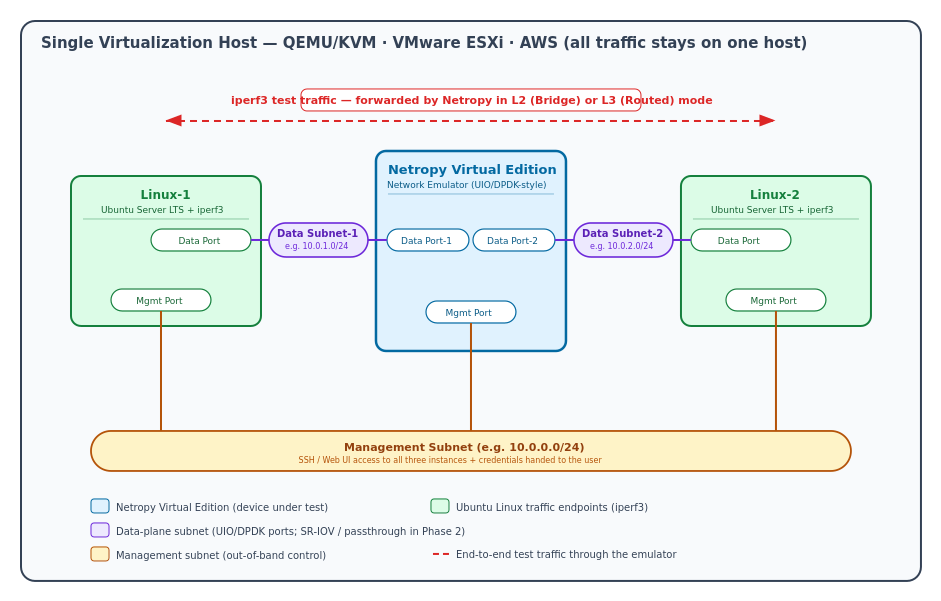
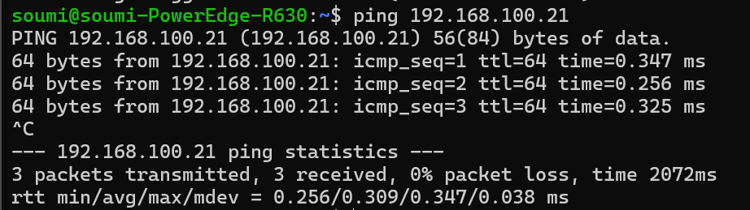
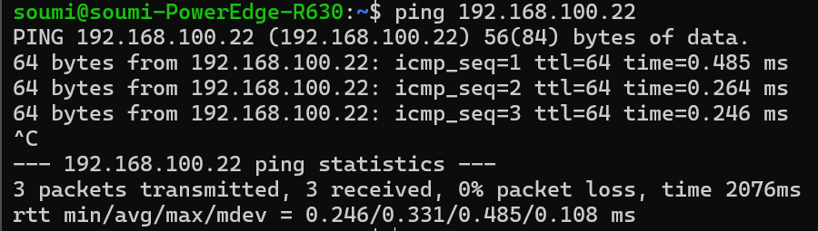
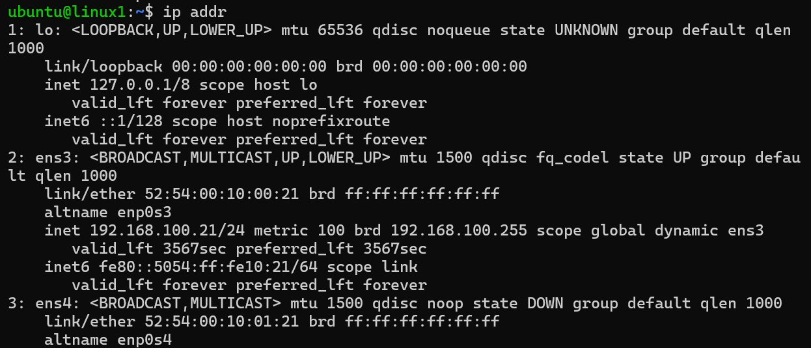
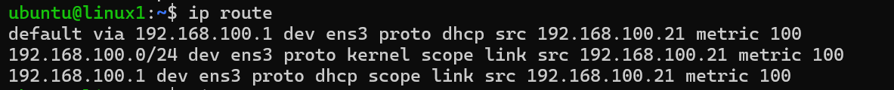
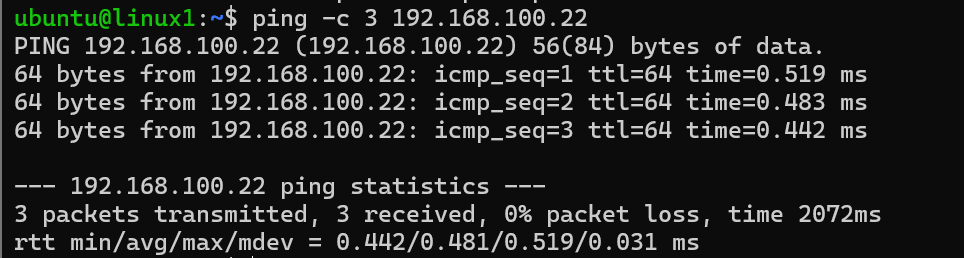
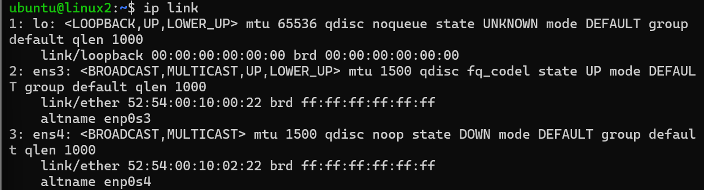
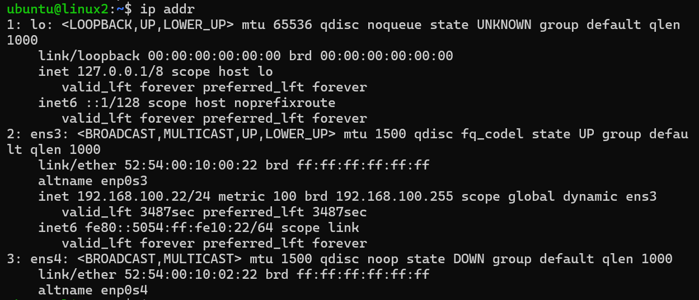
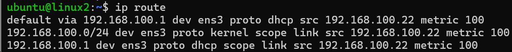
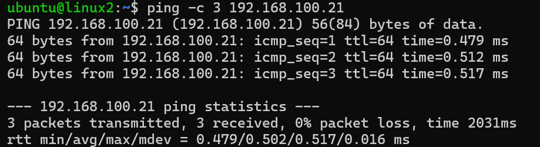

# Phase 1 — Netropy VE Test Lab Architecture Note

Netropy VE Provisioning Intern Project

## 1. Purpose

This lab is an automated **Netropy Virtual Edition (VE) test environment** on a single virtualization host. It exists so engineers can stand up a repeatable network-emulation setup without manually creating VMs in a hypervisor or cloud console.

The lab has three virtual machines on one host:

- **Netropy VE** — network emulator; traffic passes through it and emulation (delay, loss, bandwidth limits, etc.) is applied between its two data ports.
- **Linux-1** — Ubuntu traffic endpoint; runs iperf3 to generate and measure traffic.
- **Linux-2** — Ubuntu traffic endpoint; the other end of the test path.

All test traffic stays on the host. Linux-1 and Linux-2 do not share a data subnet; they talk to each other only through Netropy.

## 2. Networks

Three isolated subnets connect the VMs. See also: project_objective/netropy-topology.svg.

| **Network** | **CIDR** | **Members** | **Purpose** |
|----|----|----|----|
| Management | 192.168.100.0/24 | Netropy mgmt, Linux-1 mgmt, Linux-2 mgmt | SSH to Linux hosts; Netropy web UI / CLI |
| Data Subnet-1 | 192.168.101.0/24 | Netropy Data Port-1, Linux-1 data NIC | Traffic from Linux-1 into the emulator |
| Data Subnet-2 | 192.168.102.0/24 | Netropy Data Port-2, Linux-2 data NIC | Traffic from the emulator toward Linux-2 |

*Netropy VE test-setup topology (see project_objective/netropy-topology.svg)*

## 3. Seven Network Interfaces

| **\#** | **VM**     | **Interface** | **Subnet**    | **IP address** |
|--------|------------|---------------|---------------|----------------|
| 1      | Linux-1    | Mgmt          | Management    | 192.168.100.21 |
| 2      | Linux-1    | Data          | Data Subnet-1 | 192.168.101.21 |
| 3      | Linux-2    | Mgmt          | Management    | 192.168.100.22 |
| 4      | Linux-2    | Data          | Data Subnet-2 | 192.168.102.22 |
| 5      | Netropy VE | Mgmt          | Management    | 192.168.100.10 |
| 6      | Netropy VE | Data Port-1   | Data Subnet-1 | 192.168.101.10 |
| 7      | Netropy VE | Data Port-2   | Data Subnet-2 | 192.168.102.10 |

| **\#** | **Role of this interface**                                     |
|--------|----------------------------------------------------------------|
| 1–2    | Linux-1: admin access (mgmt); test traffic (data)              |
| 3–4    | Linux-2: admin access (mgmt); test traffic (data)              |
| 5      | Netropy: out-of-band configuration                             |
| 6–7    | Netropy: ingress from Linux-1 side; egress toward Linux-2 side |

## 4. Traffic Path

Linux-1 → Netropy → Linux-2 (forward path):

1.  Linux-1 sends packets from its data NIC (192.168.101.21) on Data Subnet-1.

2.  Packets reach Netropy Data Port-1 (192.168.101.10).

3.  Netropy applies emulation and forwards between its two data ports.

4.  Packets leave Netropy Data Port-2 (192.168.102.10) on Data Subnet-2.

5.  Packets arrive at Linux-2 data NIC (192.168.102.22).

The reverse path is the same chain in the opposite direction. The management subnet is not used for test traffic — only for SSH and Netropy configuration.

## 5. Netropy Forwarding Modes

| **Mode** | **Layer** | **What it does (beginner view)** |
|----|----|----|
| Bridge | Layer 2 | Forwards Ethernet frames between the two data ports, like a bridge. MAC addresses stay visible end-to-end. |
| Routed | Layer 3 | Routes IP packets between the two data ports, like a router between the two data subnets. |

The user chooses Bridge or Routed after the lab is provisioned, via the Netropy management interface.

## 6. Data Port Considerations

Netropy data ports use **UIO/DPDK-style userspace I/O drivers**. The Netropy software binds directly to the data-port NICs and bypasses the normal Linux kernel network stack for performance.

For Phase 1 provisioning, data ports are attached as **emulated paravirtualized NICs** (e.g. virtio on KVM). The provisioning tool must attach the correct NIC type to the correct subnet — this is a first-class design concern, not an afterthought.

## 7. Open Questions

### 7.1 Image & boot

| Question | Tag | **Why** |
|----|----|----|
| Approved image format for KVM (**qcow2**? raw?) and where to get it | **Assumed** + **Needs Product Confirmation**  | Project spec and variables.tf assume **qcow2**. Phase 0 says image comes from **Apposite team** and is **not integrated yet**. No image in images/. |
| Minimum vCPU / RAM / disk for the VE | **Assumed** | **main.tf** hardcodes **2 vCPU, 4 GiB RAM, 4 GiB disk** — placeholder, not from Netropy docs. |
| Special boot/firmware (BIOS vs UEFI) | **Assumed** + **Needs Product Confirmation** | Code uses **pc** machine type (legacy BIOS-style). Not confirmed with Netropy team. |

### 7.2 NICs

| Question | Tag | **Why** |
|----|----|----|
| NIC model for mgmt vs data (virtio, e1000, other) | **Assumed** + **Needs Product Confirmation** | Project spec §7.4 and main.tf use **virtio for all 3 NICs**. Product team must confirm the VE image accepts that. |
| NIC order fixed (mgmt = eth0, data1 = eth1, data2 = eth2) | **Assumed** + **Needs Product Confirmation** | Terraform attaches mgmt → data1 → data2 in that order. Guest naming/order inside Netropy is **not verified** |
| Emulated virtio OK for Phase 1? | **Assumed** | Project spec Phase 1 explicitly allows **emulated virtio**. Still unproven until a real Netropy VM boots. |

### 7.3 Management access

| Question | Tag | **Why** |
|----|----|----|
| Reach mgmt via web UI, SSH, or CLI only? | **Assumed** | Project spec says mgmt supports SSH / web UI / CLI. No live Netropy tested yet. |
| Default credentials for a fresh VE? | **Unknown + Needs Product Confirmation** | Spec says tool should print credentials, but no default username/password documented anywhere. |
| Mgmt reachable at assigned IP 192.168.100.10? | **Assumed + Needs Product Confirmation** | Your lab design assigns that IP via DHCP reservation. Phase 0 notes Netropy bootstrap may differ from Ubuntu cloud-init. |

### 7.4 Forwarding & traffic

| Question | Tag | **Why** |
|----|----|----|
| Bridge vs Routed set manually or pre-configured? | **Assumed** (manual for Phase 1) | Phase 1 doc + project spec: user configures **after login**. Pre-config is only a **stretch goal**. |
| L2/L3 requirements for iperf3 on emulated NICs? | **Assumed** + **Needs Product Confirmation** | Topology implies iperf3 works in Bridge (L2) or Routed (L3). No Netropy-specific traffic rules documented. |
| Static routes on data ports in Routed mode? | **Unknown** + **Needs Product Confirmation** | Not mentioned in your docs. Depends on how Netropy implements Routed mode |

### 7.5 Provisioning tool scope

| Question | Tag | **Why** |
|----|----|----|
| Tool configures Netropy or only attaches NICs? | **Assumed** *(strong — from project spec)* | Project **section 5**: configuring emulation is **out of scope**; user configures Netropy after login. Tool only provisions/wires VMs. |
| API/automation for post-boot configuration? | **Unknown** + **Needs Product Confirmation** | Stretch goal mentions an API **“where allowed”** — nothing confirmed in repo |

## 8. Hands-on networking evidence

### 8.1 Host checks

| Test | Results | Notes |
|----|----|----|
| Ping Linux-1 mgmt (192.168.100.21) – ***Figure 1*** | Success - 3/3 packets received, 0% packet loss | Management interface reachable; low, consistent latency (avg ~0.31 ms) - confirms Linux-1's mgmt NIC is correctly wired to the management subnet |
| Ping Linux-2 mgmt (192.168.100.22) – ***Figure 2*** | Success - 3/3 packets received, 0% packet loss | Management interface reachable; low, consistent latency (avg ~0.33 ms) - confirms Linux-2's mgmt NIC is correctly wired to the management subnet |

*Figure 1 - Linux_1 - ubuntu@192.168.100.21*

*Figure 2 - Linux_2 - ubuntu@192.168.100.22*

### 8.2 Linux-1 (ubuntu@192.168.100.21)

| Test | Results | Notes |
|----|----|----|
| ip link on Linux-1 - Figure 3 | **ens3:** UP · **ens4:** DOWN | Two NICs present as designed. Mgmt MAC 52:54:00:10:00:21; data MAC 52:54:00:10:01:21 matches architecture table (§3) |
| ip addr on Linux-1 - Figure 4 | **ens3:** 192.168.100.21/24 · **ens4:** no IP (DOWN) | Mgmt IP matches. Data NIC not configured yet — expected before Netropy / Phase 5 data-path setup |
| ip route on Linux-1 - Figure 5 | Default via **192.168.100.1** dev **ens3**; local route **192.168.100.0/24** | Management subnet used for default route; source IP 192.168.100.21 |
| Ping Linux-2 from Linux-1 (192.168.100.22) - Figure 6 | Success — 3/3 packets received, **0% packet loss** | VM-to-VM mgmt connectivity works; avg RTT **~0.48 ms** (min 0.442 ms, max 0.519 ms) |

*Figure 3*

*Figure 4*

*Figure 5*

*Figure 6*

### 8.3 Linux-2 (ubuntu@192.168.100.22)

| Test | Results | Notes |
|----|----|----|
| ip link — Figure 8 | **ens3: UP · ens4: DOWN** | Two NICs present. Mgmt MAC 52:54:00:10:00:22; data MAC 52:54:00:10:02:22  |
| ip addr — Figure 9 | **ens3: 192.168.100.22/24 · ens4: no IP (DOWN)** | Mgmt IP matches. Data NIC not configured yet — expected before Netropy / Phase 5 data-path setup |
| ip route — Figure 10 | Default via **192.168.100.1** dev **ens3**; local route **192.168.100.0/24** | Management subnet used for default route; source IP 192.168.100.21 |
| Ping Linux-1 mgmt (192.168.100.21) — Figure 11 | Success — 3/3 packets received, **0% packet loss** | Reverse path confirmed; avg RTT **~0.50 ms** (min 0.479 ms, max 0.517 ms) |

*Figure 7*

*Figure 8*

*Figure 9*

*Figure 10*

### 8.5 Observation

Both Linux VMs are reachable on the management subnet via SSH and ping. Each VM has two interfaces: **ens3 (management, UP)** with the correct IP from §3, and **ens4 (data, DOWN)** with no data-subnet IP yet. Default routing on both VMs uses gateway **192.168.100.1** on **ens3**. Ping between Linux-1 and Linux-2 on the management subnet succeeded with **0% packet loss** in both directions. Full data-path testing (Linux-1 → Netropy → Linux-2) was **not performed** because Netropy VE is not provisioned yet and data NICs are not active.

## 9. Verified / Assumed / Unknown / Needs Product Confirmation

### 9.1 Verified

- Both Linux VMs reachable via SSH on mgmt subnet.
- Linux-1 mgmt IP: 192.168.100.21/24 on ens3; Linux-2: 192.168.100.22/24 on ens3.
- Ping tests (host→VM and VM↔VM) succeeded with 0% packet loss.
- Each VM has ens3 (mgmt, UP) and ens4 (data, DOWN); MACs match Section 3.
- Default route on both VMs via 192.168.100.1 on ens3.

### 9.2 Assumed

- ens4 will be configured with data-subnet IPs in Phase 5.
- End-to-end iperf3 through Netropy will work once Netropy VE is provisioned.
- Tool scope is wiring/provisioning only; user configures Netropy after login.
- Bridge vs Routed is selected manually after boot (Phase 1).

### 9.3 Unknown

- Exact timing/method for data NIC (ens4) IP assignment on current VMs.
- Netropy default credentials and management access details.
- Routed-mode routing requirements on Netropy data ports.
- Existence/details of Netropy automation API.

### 9.4 Needs Product Confirmation

- See Section 7 (Open Questions) — image format/source, sizing, NIC requirements, credentials, bootstrap, and API items pending Apposite/Netropy team input.
