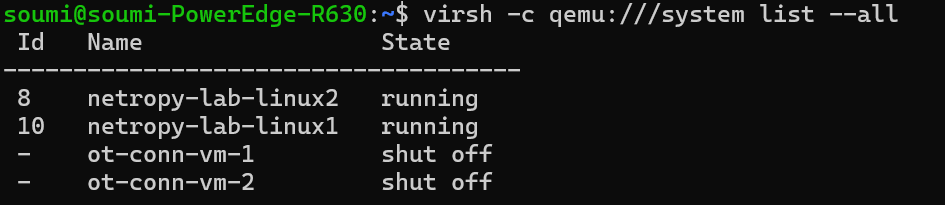
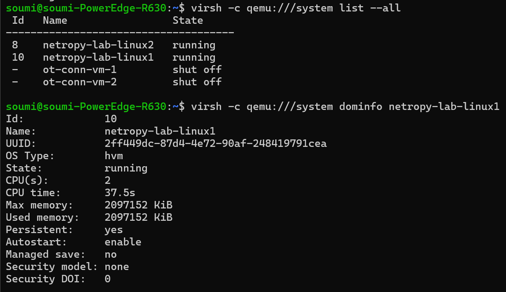
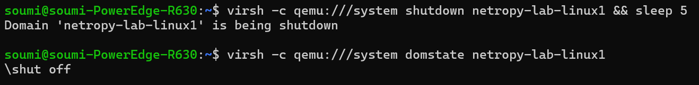
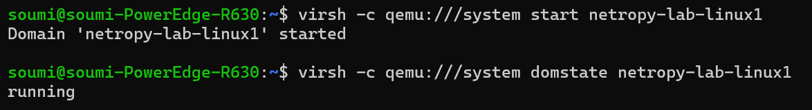
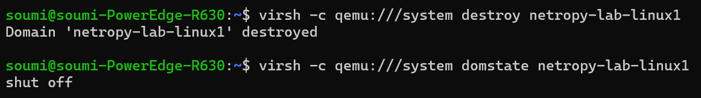

# Phase 2 — libvirt VM Lifecycle Demo

**Phase:** 2, Task 2-7\
**Date:** July 2026\
**Status:** Complete\
**Demo VM:** `netropy-lab-linux1` (OpenTofu-managed lab VM)

## Purpose

Demonstrate basic libvirt VM operations required by Phase 2:

- **Inspect** — list VMs and show domain details
- **Stop** — graceful shutdown
- **Start** — boot a stopped VM
- **Destroy** — force power-off (`virsh destroy`) and full lab teardown (`run-destroy.sh`)

All commands use the system libvirt connection: `qemu:///system`.

## 1. Inspect — list all VMs

```bash
virsh -c qemu:///system list --all
```

**Output:**



Lab VMs `netropy-lab-linux1` and `netropy-lab-linux2` were provisioned by OpenTofu (`modules/kvm/`).

## 2. Inspect — domain info

```bash
virsh -c qemu:///system dominfo netropy-lab-linux1
```

**Output:**



Same command works for `netropy-lab-linux2` (2 vCPU, 2 GiB RAM, persistent, autostart enabled).

## 3. Stop — graceful shutdown

```bash
virsh -c qemu:///system shutdown netropy-lab-linux1 && sleep 5
virsh -c qemu:///system domstate netropy-lab-linux1
```

**Output:**



## 4. Start — boot a stopped VM

```bash
virsh -c qemu:///system start netropy-lab-linux1
virsh -c qemu:///system domstate netropy-lab-linux1
```

**Output:**



## 5. Destroy — force power-off (single VM)

```bash
virsh -c qemu:///system destroy netropy-lab-linux1
virsh -c qemu:///system domstate netropy-lab-linux1
```

**Output:**



| Command | Meaning |
|----|----|
| virsh shutdown | Graceful guest |
| virsh destroy | Immediate force power-off (like pulling the plug) |
| virsh underfine | Remove VM definition from libvirt (**not run here** – would desync OpenTofu state) |

After `destroy`, the VM was started again:

```bash
virsh -c qemu:///system start netropy-lab-linux1
```

## 6. Destroy — full lab teardown (OpenTofu)

To remove **all** lab resources (VMs, networks, volumes tracked in state):

```bash
cd modules/kvm
./run-destroy.sh
# type 'destroy' when prompted
```

This runs `tofu destroy -auto-approve` and removes everything defined in `modules/kvm/main.tf`.

**Note:** Full teardown was **not executed** during this demo to keep the lab available for Phase 5 work. Use `run-destroy.sh` when intentionally resetting the environment.

See [security-guardrails.md](security-guardrails.md) for destroy safety rules.

## Command summary

| Goal             | Command                                        |
|------------------|------------------------------------------------|
| List VMs         | `virsh -c qemu:///system list --all`         |
| Inspect VM       | `virsh -c qemu:///system dominfo <name>` |
| Graceful stop    | `virsh -c qemu:///system shutdown <name>`    |
| Start VM         | `virsh -c qemu:///system start <name>`       |
| Force Stop       | `virsh -c qemu:///system destroy <name>`     |
| Start lab VMs    | `modules/kvm/run-start.sh`                     |
| Destroy full lab | `modules/kvm/run-destroy.sh`                   |

------------------------------------------------------------------------

## Verified / Assumed / Unknown

### Verified

- Can list, inspect, shutdown, start, and force-destroy `netropy-lab-linux1` via virsh.
- Lab VMs are persistent and autostart-enabled.
- VM returned to `running` state after start following shutdown and destroy.

### Assumed

- OpenTofu state remains consistent when using `shutdown`/`start`/`destroy` without `undefine`.
- Full lab teardown via `run-destroy.sh` works as documented (verified separately during development).

### Unknown

- None for basic virsh lifecycle operations.
