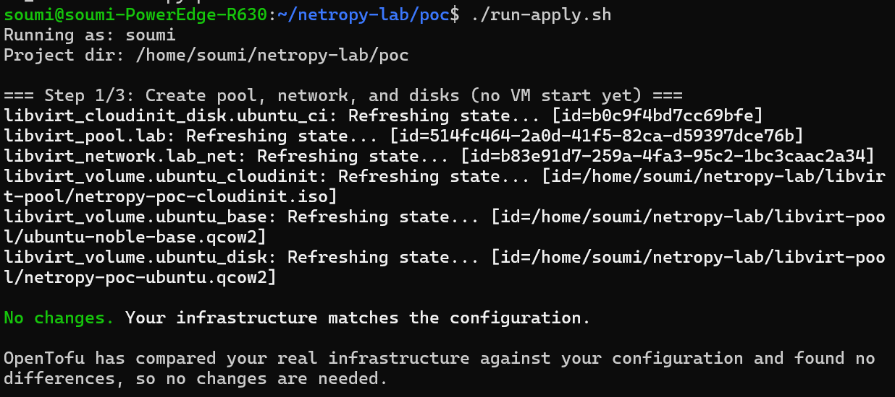
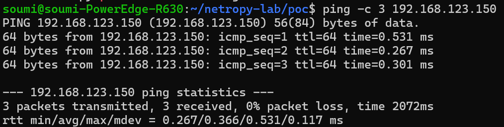
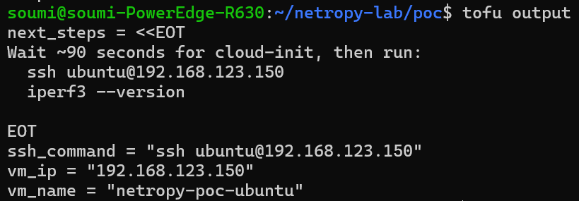
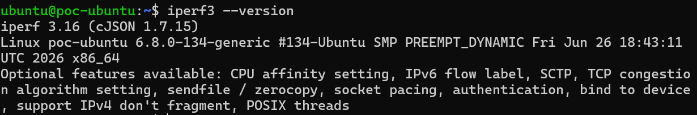

# Phase 3 — Provisioning Tool Selection and Proof-of-Concept Results

Netropy VE Provisioning Intern Project

## 1. Executive Summary

This document surveys provisioning tooling for automating a Netropy Virtual Edition (VE) test lab on KVM, VMware ESXi, and AWS. After comparing realistic candidates, I recommend:

- Infrastructure as Code (IaC) engine: OpenTofu (Terraform-compatible, MPL-2.0 licensed)

- Platform providers: dmacvicar/libvirt (KVM), vmware/vsphere (ESXi), hashicorp/aws (AWS)

- Guest bootstrap: cloud-init (Ubuntu endpoints)

- User interface: Thin Python CLI that validates JSON, invokes OpenTofu, and prints an access summary

I validated this stack with a working KVM proof-of-concept: one Ubuntu 24.04 VM boots from a cloud image, receives a static IP via cloud-init, installs iperf3, and tears down cleanly with tofu destroy. This POC de-risks the hardest unknown — whether the chosen tools work together on the development host.

Recommendation: Proceed with the OpenTofu + per-platform provider module design described in the project specification. No blocking provider limitation was found for KVM.

## 2. Problem Statement

The tool must read one JSON configuration file and provision, on a single host:

| **Instance** | **NICs**        | **Role**                |
|--------------|-----------------|-------------------------|
| Netropy VE   | 1 mgmt + 2 data | Network emulator        |
| Linux-1      | 1 mgmt + 1 data | iperf3 traffic endpoint |
| Linux-2      | 1 mgmt + 1 data | iperf3 traffic endpoint |

Three isolated subnets (management, data-1, data-2) connect the correct interfaces. The user must be able to create and destroy the entire lab with single commands, without manual hypervisor UI steps.

**Key non-functional requirements:**

- Repeatable — same JSON input produces the same topology every time

- Idempotent — re-running converges to desired state

- Destroyable — clean teardown without orphaned resources

- Multi-platform — one workflow, three backends (KVM, ESXi, AWS)

## 3. Candidate Tools Surveyed

### 3.1 Infrastructure-as-Code engines

| **Tool** | **License / governance** | **Strengths** | **Weaknesses for this project** |
|----|----|----|----|
| OpenTofu | MPL-2.0, Linux Foundation / CNCF | Drop-in Terraform replacement; full provider ecosystem; declarative state | Smaller brand recognition than Terraform |
| Terraform | BSL 1.1 (HashiCorp / IBM) | Same HCL model; largest community | License restrictions for some commercial redistribution scenarios |
| Pulumi | Apache 2.0 | Real programming languages (Python, Go) | No advantage here; KVM/ESXi providers are HCL-first; adds complexity |
| Ansible only | GPL | Good for post-boot SSH config | Not ideal as primary provisioner for VM lifecycle + networking on all three platforms |

### 3.2 Guest bootstrap

| **Tool** | **Role** | **Verdict** |
|----|----|----|
| cloud-init | First-boot user, SSH key, packages, static IPs | Required — standard on Ubuntu cloud images across KVM, vSphere, and AWS |
| Packer | Pre-bake golden images | Optional; cloud-init installing iperf3 at boot is simpler for a disposable lab |
| Ansible | Post-boot configuration | Useful later for passthrough host-side Linux bridge wiring; not needed for Phase 1 emulated NICs |

### 3.3 Platform-native CLIs (rejected as primary approach)

| **Platform** | **Native tools** | **Why not alone** |
|----|----|----|
| KVM | virsh, virt-install | Would require separate imperative scripts per platform |
| ESXi | govc, PowerCLI | Same — three codebases to maintain |
| AWS | AWS CLI / SDK | Same |

### 3.4 Dev-VM wrappers

Vagrant is oriented at developer workstations, not multi-cloud production-style lab provisioning. It lacks the structured state management and destroy semantics needed for a shippable internal tool.

## 4. Provider Health Review

Workbook Phase 3 requires verifying current provider health for libvirt, vSphere, and AWS. Reviewed July 2026:

| **Provider** | **Source** | **Status checked** | **Notes** |
|----|----|----|----|
| dmacvicar/libvirt | OpenTofu / Terraform Registry | Verified in POC (v0.9.8) | Creates pools, networks, volumes, cloud-init disks, and domains on qemu:///system. No blocking KVM limitation found. |
| vmware/vsphere | Official VMware/Broadcom provider | Docs / capability review (not live-tested) | Supports OVF/OVA or template deploy, port groups, guest customization / cloud-init path. Live ESXi access pending. |
| hashicorp/aws | Official HashiCorp AWS provider | Docs / capability review (not live-tested) | Supports VPC, subnets, EC2, ENIs, user-data. Single-host and passthrough semantics differ on EC2 — document in later phase. |

Exit-gate note: KVM is unblocked. ESXi and AWS are deferred until platform access is available; they are not Phase 3 blockers.

## 5. Evaluation Criteria

| **Criterion** | **Weight** | **Notes** |
|----|----|----|
| Multi-platform coverage | High | Must support KVM, ESXi, AWS with one mental model |
| Provider maturity | High | Official or actively maintained providers for all targets |
| Declarative + stateful | High | Create/destroy/idempotency are core requirements |
| Intern learning curve | Medium | Documented tools with large community help |
| License fit | Medium | Open-source friendly for a new internal tool |
| Guest bootstrap portability | High | Write once, run on all Ubuntu instances |

## 6. Proof-of-Concept Results (KVM)

### 6.1 Environment

| **Component** | **Version / detail** |
|----|----|
| Host OS | Linux with QEMU/KVM (development host; earlier trials also used Windows 11 + WSL2 Ubuntu 24.04) |
| Hypervisor | QEMU/KVM via libvirt (qemu:///system) |
| IaC engine | OpenTofu v1.12.4 |
| Provider | dmacvicar/libvirt v0.9.8 |
| Base image | Ubuntu 24.04 noble cloud image (noble-server-cloudimg-amd64.img) |

### 6.2 What the POC does

The POC (netropy-lab/poc/) provisions:

- A libvirt storage pool and NAT network (192.168.123.0/24)

- A qcow2 overlay disk chained from the Ubuntu cloud image

- A cloud-init ISO (user ubuntu, SSH key, iperf3 + qemu-guest-agent)

- A single VM (netropy-poc-ubuntu, 2 vCPU, 2 GB RAM) with static IP 192.168.123.150

Apply and destroy are scripted (run-apply.sh, run-destroy.sh).

### 6.3 OpenTofu outputs (management IP)

Workbook requirement: expose the VM management IP as an OpenTofu output. Implemented in poc/outputs.tf:

| **Output**  | **Purpose**                                    |
|-------------|------------------------------------------------|
| vm_name     | Name of the proof-of-concept VM                |
| vm_ip       | Static management IP (192.168.123.150)         |
| ssh_command | Ready-to-use SSH command                       |
| next_steps  | Reminders for cloud-init wait and iperf3 check |

Example: tofu output -raw vm_ip → 192.168.123.150

### 6.4 cloud-init bootstrap

cloud-init (NoCloud via libvirt cloud-init disk) creates:

- Login user: ubuntu with passwordless sudo

- SSH authorized key from ~/.ssh/id_ed25519.pub

- Packages: iperf3 and qemu-guest-agent

- Static IP via network-config MAC match

### 6.5 Key findings from the POC

| **Finding** | **Impact on full build** |
|----|----|
| libvirt provider v0.9 API differs significantly from v0.8 | All HCL must use the new object-based schema (not legacy blocks). |
| WSL2 nested KVM requires explicit enablement (when used) | Document .wslconfig + wsl --shutdown if developing on WSL2. |
| libvirt pool permissions matter | Pool directory ownership and path traversal (o+x) must be correct for QEMU. |
| cloud-init static IP via MAC match works reliably | Same pattern scales to multi-NIC Ubuntu VMs in the full lab. |
| Do not run apply scripts with sudo | Scripts use sg libvirt; sudo breaks \$HOME and SSH key paths. |
| OpenTofu + libvirt is viable on the intern host | KVM can be the first platform module without requiring a dedicated bare-metal lab host for early development. |

### 6.6 Destroy verification

Teardown uses tofu destroy (via ./run-destroy.sh). The script removes OpenTofu-managed resources and cleans leftover libvirt objects for the POC (domain, network, pool) when needed. This satisfies the workbook requirement to destroy the proof-of-concept cleanly.

### 6.7 Sample commands (sanitized evidence)

Typical verification sequence:

```bash
cd ~/netropy-lab/poc
./run-apply.sh        # or: tofu init && tofu apply
# wait ~90 seconds for cloud-init
tofu output
ssh ubuntu@$(tofu output -raw vm_ip)
iperf3 --version
./run-destroy.sh      # or: tofu destroy
```









### 6.8 POC limitations (expected)

- Single VM and single network — not yet the full 3-VM / 3-subnet topology

- Netropy VE image not yet integrated (awaiting image from product team)

- Python CLI is scaffolded separately; POC itself still uses OpenTofu directly

- These are later-phase scope items, not blockers for tool selection

## 7. Recommended Architecture

### 7.1 Why OpenTofu over Terraform

- MPL-2.0 open-source license without BSL usage restrictions

- Neutral governance (Linux Foundation / CNCF)

- Drop-in compatibility — same providers, same workflows

### 7.2 Why cloud-init for Ubuntu endpoints

- Supported on Ubuntu cloud images for KVM, vSphere, and AWS

- One YAML template per instance role, parameterized with JSON values

- Handles users, SSH keys, packages, and multi-interface static IP

### 7.3 Why a Python CLI wrapper

The project specification requires JSON in, access summary out. A thin CLI:

- Validates JSON (fields, IP/subnet consistency, image paths)

- Selects the platform module (kvm / esxi / aws)

- Writes variables and runs tofu init / apply / destroy

- Parses OpenTofu outputs and prints SSH commands, Netropy management URL, and an iperf3 reminder

### 7.4 Netropy VE considerations

Netropy data ports use UIO/DPDK-style drivers. For Phase 1 (emulated NICs):

- Attach data NICs as emulated paravirtualized interfaces (virtio on KVM, VMXNET3 on ESXi, ENA on AWS)

- Static IP assignment for Netropy may differ from Ubuntu cloud-init — Needs Product Confirmation

- Image is an input from the product team, not built by this tool

## 8. Alternatives Considered and Rejected

| **Alternative** | **Reason rejected** |
|----|----|
| Three separate platform scripts (virsh / govc / aws cli) | Triple maintenance burden; no shared state model |
| Ansible as primary provisioner | Weaker first-class support for libvirt VM lifecycle; better as adjunct |
| Pulumi Python for all IaC | Re-learning provider APIs; no benefit over HCL modules |
| Vagrant | Dev-box focused; poor fit for multi-cloud declarative lab |
| Manual UI provisioning | Violates core project requirement |

## 9. Risks and Mitigations

| **Risk** | **Mitigation** |
|----|----|
| libvirt provider API changes | Pin provider version (~\> 0.9); POC documents working schema |
| WSL2 nested virt performance | Acceptable for early dev; production labs on bare-metal KVM or ESXi |
| Netropy image bootstrap unknown | Request image + docs early; gate Netropy VM until validated |
| ESXi/AWS access delayed | Complete KVM module first; request credentials early |
| Multi-NIC cloud-init complexity | POC proved MAC-based static IP; extend network-config per interface |

## 10. Verified, Assumed, Unknown, and Mentor Decisions

### 10.1 Verified

- OpenTofu v1.12.4 runs on the development host

- dmacvicar/libvirt v0.9.8 can create pool, network, volume, cloud-init disk, and domain

- cloud-init creates ubuntu user, injects SSH public key, and installs iperf3

- Static management IP is applied and exposed via OpenTofu output vm_ip

- POC can be destroyed with tofu destroy / run-destroy.sh

- No blocking limitation found for KVM as the first platform

### 10.2 Assumed

- vSphere and AWS providers will support an equivalent module pattern once access exists

- virtio (KVM) is acceptable for Netropy data ports in emulated Phase 1 mode

- Company accepts OpenTofu (vs Terraform) for this greenfield internal tool

### 10.3 Unknown / open questions

- Netropy VE qcow2 image availability, boot mode, and minimum resources

- Required NIC model and deterministic NIC order for Netropy on KVM

- How Netropy assigns or expects management and data-port IPs

- Timeline for ESXi/vCenter and AWS lab credentials

### 10.4 Needs mentor / product confirmation

- Approve OpenTofu + cloud-init + thin Python CLI as the official stack

- Confirm Netropy image delivery plan and documentation contact

- Confirm whether Terraform is mandated by company policy (if so, design is unchanged; only binary changes)

## 11. Learning Notes (Phase 3)

- OpenTofu: configuration = desired state; providers talk to APIs; state tracks real resources; outputs expose values like VM IP after apply.

- cloud-init NoCloud: libvirt attaches a small ISO with user-data / meta-data / network-config; guest applies it on first boot.

- Idempotence: re-running tofu apply against the same config should converge without creating duplicate VMs when state is intact.

- libvirt URI qemu:///system is the host-wide KVM manager used by virsh and the OpenTofu libvirt provider.

## 12. Next Steps (after Phase 3 approval)

- Workbook Phase 4 — harden JSON configuration contract and validation tests

- Workbook Phase 5 — full KVM lab (3 networks, 2 Linux VMs, Netropy when image available)

- Continue Python CLI — validate / up / down with access summary

- Request — Netropy VE qcow2 image, ESXi or AWS lab access

## 13. Conclusion

The surveyed tooling landscape supports a single declarative engine with swappable per-platform modules. OpenTofu, cloud-init, and the libvirt/vSphere/AWS providers are mature enough for an intern-scale project. The KVM proof-of-concept confirms the stack works in the development environment.

I recommend endorsing this architecture and closing workbook Phase 3 upon mentor approval, then proceeding to Phase 4 (JSON contract) and the full KVM lab build.

## Appendix A — POC file locations

| **Path**                                  | **Purpose**                    |
|-------------------------------------------|--------------------------------|
| netropy-lab/poc/main.tf                   | OpenTofu libvirt configuration |
| netropy-lab/poc/outputs.tf                | vm_ip and SSH outputs          |
| netropy-lab/poc/cloud-init/user-data.yaml | Guest bootstrap                |
| netropy-lab/poc/run-apply.sh              | Apply helper (no sudo)         |
| netropy-lab/poc/run-destroy.sh            | Teardown helper                |
