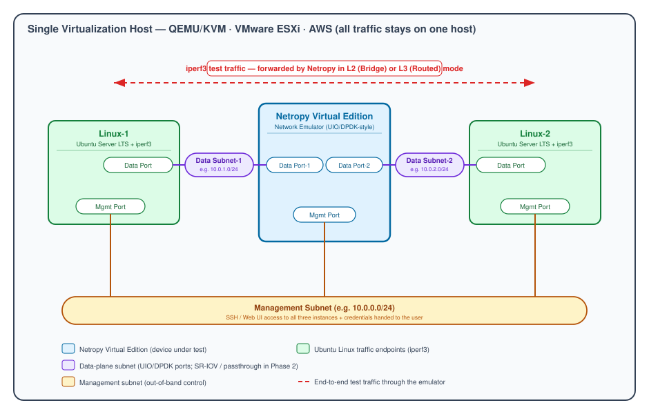

# Intern Project — Automated Provisioning of a Netropy Virtual Edition Test Setup

**Product:** Netropy Network Emulator — Virtual Edition
**Target platforms:** QEMU/KVM · VMware ESXi · AWS
**Document type:** Intern project definition / requirements specification
**Status:** Draft for review

---

## 1. Summary

Build a command-line tool that stands up a complete, ready-to-use Netropy test lab on a **single virtualization or cloud host**, with no manual clicking through hypervisor or cloud consoles. The tool reads one JSON file describing the desired lab (images, OS version, IP addressing, credentials) and produces three running instances — one **Netropy Virtual Edition (VE)** instance and two **Ubuntu Linux** traffic endpoints — wired together on the correct networks. When it finishes, it prints how to reach each instance and the login credentials, so the user can log in, configure the emulator, and run traffic.

The project is deliberately scoped so that the **research and tool-selection phase comes first**: the intern surveys the modern provisioning ecosystem, justifies a choice in writing, and only then builds.

---

## 2. Background

The Netropy Network Emulator VE presents three virtual NICs:

- **1 × Management port** — out-of-band control (SSH / web UI).
- **2 × Data ports** — carry the traffic being emulated. Depending on how the Netropy instance is configured, traffic is forwarded between the two data ports in either **Bridge (Layer 2)** mode or **Routed (Layer 3)** mode.

The data ports are driven by **custom userspace I/O (UIO) drivers**, conceptually similar to DPDK: the Netropy software binds the data-port NICs directly and bypasses the normal Linux kernel network stack for performance. This matters for provisioning because the **type of virtual NIC attached to the data ports, and how it is presented to the guest, is a first-class design concern** — not an afterthought (see §7.4).

Today the VE is supported on QEMU/KVM, VMware ESXi, and AWS. A single automation tool that covers all three keeps test-lab setup consistent and repeatable across environments.

---

## 3. The test setup (topology)

All three instances live on **one host**; traffic never leaves that host.



**Networks / subnets:**

| Subnet | Members | Purpose |
|---|---|---|
| **Management Subnet** | Netropy Mgmt · Linux-1 Mgmt · Linux-2 Mgmt | Control-plane: SSH into the Linux hosts, reach the Netropy web UI / CLI |
| **Data Subnet-1** | Netropy Data Port-1 · Linux-1 Data Port | Traffic from Linux-1 into the emulator |
| **Data Subnet-2** | Netropy Data Port-2 · Linux-2 Data Port | Traffic from Linux-2 into the emulator |

**Data path:** Linux-1 → Netropy Data Port-1 → *(emulation applied)* → Netropy Data Port-2 → Linux-2 (and the reverse). Netropy forwards between the two data ports in Bridge (L2) or Routed (L3) mode. The Linux endpoints run **iperf3** to generate and measure the traffic.

---

## 4. Goals and end state

### 4.1 Primary goal (the "definition of done")

> A single tool that, given one JSON input file, creates and launches a Netropy VE instance plus two Ubuntu Linux instances on a chosen host (KVM, ESXi, or AWS), wires them onto the management subnet and the two data subnets exactly as shown in §3, and on completion prints a clear access summary — hostnames/IPs, connection method, and credentials — for all three instances. The user then logs in to configure the emulator and run traffic end-to-end.

### 4.2 What "success" looks like concretely

A user with a fresh host and the JSON file runs one command, waits, and can then:

1. SSH into Linux-1 and Linux-2 over the management subnet using the printed credentials.
2. Reach the Netropy management interface over the management subnet.
3. Configure Netropy in Bridge or Routed mode.
4. Run `iperf3` from Linux-1 to Linux-2 (and back) with the traffic passing through the Netropy emulator, and observe the emulation effects.
5. Tear the whole lab down again with a single command.

---

## 5. Scope

### 5.1 Phase 1 — Core automation (required)

- One tool, one JSON input, three platforms (KVM, ESXi, AWS).
- Instantiate the Netropy VE from a **local image file** specified in the JSON.
- Instantiate two Ubuntu Server LTS instances (version from the JSON) and install **iperf3** on each.
- Create/attach the three subnets and assign the interface IP addresses from the JSON.
- Netropy data ports operate in the normal **emulated-NIC** mode (Bridge/Routed selectable by the user after login).
- Print an access + credentials summary on success.
- Provide a clean teardown.

### 5.2 Phase 2 — Passthrough data ports (optional / stretch)

- Instantiate Netropy with its **data ports in passthrough mode** (PCI passthrough / SR-IOV / DirectPath I/O, depending on platform).
- Because the data ports are now passed through, the Linux endpoints must be connected to those passthrough ports via an **external mechanism** — for example a **Linux bridge on the host** joining a Linux VM's data NIC to the physical/virtual function that Netropy owns.
- Same end result: `iperf3` between Linux-1 and Linux-2 via the emulator.

### 5.3 Out of scope

- Multi-host / distributed setups (everything stays on one host).
- Production hardening, HA, or long-term lifecycle management.
- Building the Netropy image itself (the image is an input).
- Configuring the emulation scenarios inside Netropy (the user does this after login).

---

## 6. Phase 0 — Research and tool selection (do this first, and write it up)

The intern's **first deliverable is a short written recommendation** (2–4 pages) that surveys the current provisioning tooling, compares the realistic candidates, and justifies the selection. The section below is a **starting map of the landscape as of 2026** plus a recommended direction; the intern should validate it, adjust for anything that changed, and make the final call with their mentor.

### 6.1 Candidate tools

| Category | Tool | What it does | Fit for this project |
|---|---|---|---|
| **IaC / provisioning engine** | **OpenTofu** | Declarative infrastructure-as-code (HCL); fork of Terraform under the Linux Foundation/CNCF, MPL-2.0 licensed, drop-in compatible with the Terraform provider ecosystem | **Strong** — one engine, three platforms via providers |
| | **Terraform** | Same model as OpenTofu; developed by HashiCorp (now IBM), Business Source License since 1.6 | Strong, but license posture is the main reason many new projects pick OpenTofu instead |
| | **Pulumi** | IaC using general-purpose languages (Python, TS, Go) | Viable, but smaller provider ecosystem and no real advantage here over HCL |
| **Config management** | **Ansible** | Agentless post-boot configuration over SSH; also has cloud/hypervisor modules | Best used *alongside* the IaC engine for in-guest steps (install iperf3, set up the Phase-2 Linux bridge) |
| **Guest bootstrap** | **cloud-init** | Industry-standard first-boot init: users, SSH keys, static IPs, package installs | Essential building block regardless of engine — how each VM configures itself on first boot |
| **Image build** | **Packer** | Builds golden machine images per platform | Optional; only needed if we pre-bake the iperf3 image instead of installing at boot |
| **Dev-VM wrapper** | **Vagrant** | Scriptable local VM environments | Weak fit — oriented at dev boxes, weaker multi-cloud story, less suited to a shippable tool |
| **Platform-native** | AWS CLI/SDK, `virsh`/libvirt, `govc`/PowerCLI | Each platform's own API/CLI | Powerful but would mean writing and maintaining **three separate codebases** |

### 6.2 Recommended direction (to be confirmed by the intern)

**Use one IaC engine with a per-platform provider module, cloud-init for in-guest bootstrap, and a thin CLI wrapper that turns the JSON input into an engine run.**

Concretely:

- **Engine: OpenTofu** (Terraform-compatible). Rationale below.
- **Providers, one per platform:**
  - AWS → the official `aws` provider (mature, first-class).
  - VMware ESXi → the `vmware/vsphere` provider (official, actively maintained under Broadcom; supports deploying from templates/OVF with cloud-init customization, port groups, etc.).
  - QEMU/KVM → the community `dmacvicar/libvirt` provider (actively released in 2026; supports local `qcow2` images, cloud-init disks, and custom libvirt networks).
- **Guest bootstrap: cloud-init** on the two Ubuntu instances — creates the login user, sets the static IPs on all interfaces, and installs `iperf3`.
- **Optional config layer: Ansible** for anything cloud-init is awkward for, and especially for the **Phase-2 host-side Linux bridge** wiring.
- **The "tool" itself: a thin Python CLI** that (1) reads and validates the JSON, (2) selects the platform module, (3) renders variables and invokes the engine, and (4) reads the engine outputs to print the access + credentials summary.

### 6.3 Why this selection

1. **One workflow, three platforms.** A single declarative engine with three swappable provider modules avoids maintaining three unrelated codebases. The intern learns one mental model (declare desired state → engine reconciles) and applies it everywhere.
2. **Mature, well-documented providers exist for all three targets.** AWS and vSphere are officially supported; KVM has a healthy community provider with recent releases. This de-risks the build for an intern-scale project.
3. **Declarative + idempotent + destroyable.** State tracking means "create the lab" and "destroy the lab" are first-class, repeatable operations — exactly what a disposable test lab needs.
4. **cloud-init is the standard bootstrap path** on all three platforms, so per-guest setup (users, static IPs, iperf3) is written once in a portable form.
5. **OpenTofu over Terraform for a greenfield tool:** OpenTofu is open-source under MPL-2.0 with neutral (Linux Foundation / CNCF) governance and is a drop-in replacement that reuses the same providers and HCL. For a brand-new internal tool this avoids the Business Source License questions that come with recent Terraform releases, at essentially no technical cost. *If company policy already standardizes on Terraform, the same design works unchanged — this is a licensing/governance choice, not a technical one, and the intern should confirm the local preference.*
6. **A thin CLI wrapper keeps the UX simple** (one JSON in, one summary out) while all the heavy lifting stays in well-understood tools rather than bespoke code.

> **Intern task:** treat §6.1–6.3 as a hypothesis. Confirm current versions and provider health, build a tiny proof-of-concept on the easiest platform (KVM locally is usually fastest), and then either endorse or revise this recommendation in the written write-up before committing to the full build.

---

## 7. Functional requirements

### 7.1 Input — the JSON configuration file

The tool takes exactly one JSON file. Minimum contents:

- **Target platform** — one of `kvm` | `esxi` | `aws`.
- **Netropy image** — path to the image **on the local machine** (e.g. a `qcow2`/`ova` for KVM/ESXi, or an AMI/image reference workflow for AWS).
- **Ubuntu Server LTS version** — e.g. `24.04`.
- **IP addressing** for every interface that needs one, across all three instances (management + both data subnets).
- **Credentials required to reach the platform** — e.g. AWS access key/secret (or profile/role), ESXi/vCenter username + password. (Read from environment or a secrets store where possible rather than committing secrets to the JSON.)
- **Optional:** instance sizing (vCPU/RAM/disk), naming prefix, SSH public key, subnet CIDRs, Phase-2 passthrough flag.

**Illustrative schema (KVM example):**

```json
{
  "platform": "kvm",
  "netropy_image": "/home/user/images/netropy-ve.qcow2",
  "ubuntu_lts_version": "24.04",
  "naming_prefix": "netropy-lab",
  "ssh_public_key_file": "~/.ssh/id_ed25519.pub",
  "subnets": {
    "mgmt": { "cidr": "10.0.0.0/24" },
    "data1": { "cidr": "10.0.1.0/24" },
    "data2": { "cidr": "10.0.2.0/24" }
  },
  "instances": {
    "netropy": {
      "mgmt_ip":  "10.0.0.10",
      "data1_ip": "10.0.1.10",
      "data2_ip": "10.0.2.10"
    },
    "linux1": { "mgmt_ip": "10.0.0.21", "data_ip": "10.0.1.21" },
    "linux2": { "mgmt_ip": "10.0.0.22", "data_ip": "10.0.2.22" }
  },
  "options": {
    "passthrough_data_ports": false,
    "vcpu": 2,
    "memory_mb": 4096
  },
  "credentials": {
    "note": "For esxi/aws, supply platform creds here or via environment variables / a profile."
  }
}
```

The tool must **validate** the JSON (required fields present, IPs inside the right subnets, image path exists, platform recognized) and fail early with a clear message if not.

### 7.2 Provisioning behavior

- Create the three subnets/networks on the target platform.
- Launch the Netropy VE from the supplied image with 1 management NIC + 2 data NICs attached to the correct subnets.
- Launch two Ubuntu LTS instances, each with 1 management NIC + 1 data NIC on the correct subnets.
- Apply the static IPs from the JSON to every interface.
- Install `iperf3` on both Linux instances.
- Be **idempotent** (re-running converges to the same state) and provide **teardown**.

### 7.3 Output — access summary

On success, print (and optionally write to a file) a summary containing, for each of the three instances:

- Name / role.
- How to reach it (management IP; SSH command for the Linux hosts; URL or CLI hint for Netropy).
- Credentials (username + password, or the SSH key used).
- The data-port IPs and which data subnet each is on.
- A one-line reminder of how to run the end-to-end iperf3 test.

### 7.4 Data-port / driver considerations (important)

Because the Netropy data ports use UIO/DPDK-style userspace drivers:

- **Phase 1 (emulated NICs):** attach the data ports as regular paravirtualized NICs (e.g. `virtio` on KVM, VMXNET3 on ESXi, ENA on AWS). The Netropy software binds them internally. The provisioning tool's job is simply to ensure the **right NIC type is attached to the right subnet** — document any NIC-model requirements the Netropy image has.
- **Phase 2 (passthrough):** the data ports are presented via **PCI passthrough / SR-IOV**:
  - **KVM:** `vfio-pci` passthrough of a PF/VF; connect the Linux endpoint's data NIC to the same segment via a **host Linux bridge** (this is the "external mechanism" in the brief).
  - **ESXi:** DirectPath I/O or SR-IOV virtual functions.
  - **AWS:** enhanced networking (ENA / SR-IOV) is the closest analogue; document what "passthrough" means and is achievable in a single-host EC2 context.
- The intern should **document, per platform, exactly how the data ports are presented in each phase** — this is one of the more subtle parts of the project.

---

## 8. Non-functional requirements

- **Repeatable & idempotent** — same JSON produces the same lab; safe to re-run.
- **Single-command UX** — one command to build, one to destroy.
- **Clear failure messages** — validation and provisioning errors are actionable.
- **Secret hygiene** — never print secrets to logs; prefer env vars / profiles / a secrets store over secrets in the JSON.
- **Documented** — a README covering prerequisites per platform, how to write the JSON, and how to run/destroy.
- **Version-controlled** — all code and the IaC modules live in git.

---

## 9. Suggested milestones (≈ 10–12 weeks)

| Phase | Weeks | Deliverable |
|---|---|---|
| **0 — Research** | 1–2 | Written tool comparison + recommendation; tiny KVM proof-of-concept that boots one VM via the chosen engine + cloud-init |
| **1a — KVM end-to-end** | 3–5 | Full three-instance lab on KVM from the JSON; iperf3 passes through Netropy; access summary printed; teardown works |
| **1b — Second platform** | 6–7 | Same result on **ESXi** (or AWS); refactor shared logic into per-platform modules |
| **1c — Third platform** | 8–9 | Third platform working; JSON validation hardened; README complete |
| **2 — Passthrough (optional)** | 10–11 | Passthrough data ports on at least one platform, with the host Linux-bridge wiring |
| **Wrap-up** | 12 | Demo, documentation polish, handover |

Adjust based on how fast the research phase converges and how much hypervisor/cloud access the intern gets early.

---

## 10. Acceptance criteria (Definition of Done)

**Phase 1 is complete when, on at least the primary platform:**

1. A single command + the JSON file produces a running Netropy VE and two Ubuntu LTS instances wired per §3.
2. All interfaces have the IPs specified in the JSON.
3. `iperf3` is installed on both Linux hosts.
4. The user can SSH to both Linux hosts and reach Netropy using the printed access summary.
5. With Netropy configured (Bridge or Routed), `iperf3` traffic flows Linux-1 ↔ Linux-2 **through** the emulator.
6. A single teardown command removes everything.
7. Re-running the build is idempotent.
8. Prerequisites, JSON format, and usage are documented in a README.

**Phase 2 (if attempted)** adds: the same working iperf3 result with Netropy data ports in passthrough mode and the Linux endpoints joined via the external (Linux-bridge) mechanism.

---

## 11. Risks and considerations

- **Platform access.** ESXi/vCenter and AWS credentials + quota may take time to obtain — start the access request on day one.
- **Netropy NIC requirements.** The VE image may require specific NIC models or boot settings; confirm early with the Netropy team.
- **Passthrough complexity.** SR-IOV/PCI-passthrough depends on host hardware (IOMMU, capable NICs) and differs sharply per platform — that's why Phase 2 is optional.
- **AWS single-host semantics.** "Everything on one host" and "passthrough" map imperfectly onto EC2; the intern should document how the model is realized (or note limitations) rather than force an exact analogue.
- **Secret handling.** Credentials in a JSON file are convenient but risky; design for env vars / profiles from the start.

---

## 12. Stretch goals

- A small config-check command that verifies the lab end-to-end (pings across each subnet, a short automated iperf3 run) and reports pass/fail.
- Support choosing Bridge vs Routed as a JSON option that pre-configures Netropy where the API allows.
- A minimal web or TUI front-end over the JSON.
- CI that lints the IaC and runs a KVM smoke test.

---

## 13. Skills the intern will build

Infrastructure-as-code (OpenTofu/Terraform + HCL), cloud-init, Linux networking (bridges, subnets, SR-IOV/passthrough basics), AWS + VMware + KVM fundamentals, a bit of Python for the CLI wrapper, iperf3, and clear technical writing (the research write-up and README).

---

## 14. References (validate current versions during Phase 0)

- OpenTofu — https://opentofu.org/
- OpenTofu vs Terraform (2026 comparisons) — e.g. spacelift.io, env0.com, scalr.com learning centers
- Terraform vSphere provider (official, VMware/Broadcom) — https://github.com/vmware/terraform-provider-vsphere
- Terraform libvirt (KVM) provider — https://github.com/dmacvicar/terraform-provider-libvirt
- Terraform AWS provider — registry.terraform.io (hashicorp/aws)
- cloud-init documentation — https://cloudinit.readthedocs.io/
- Ansible documentation — https://docs.ansible.com/
- iperf3 — https://iperf.fr/

*(Netropy VE image, its NIC/driver requirements, and management-interface details come from the internal Netropy product documentation.)*
